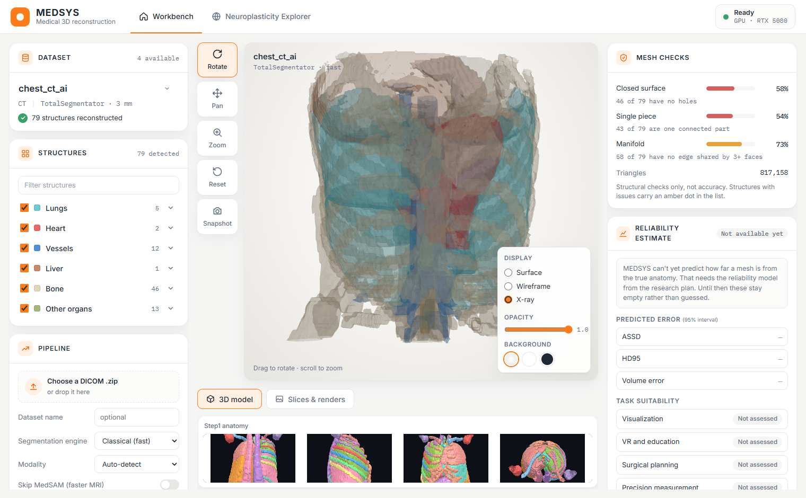
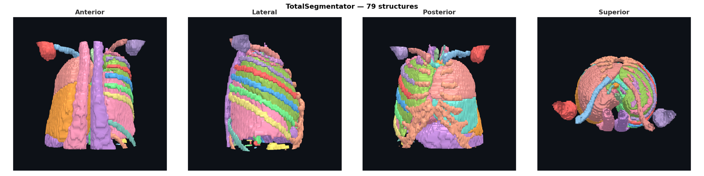
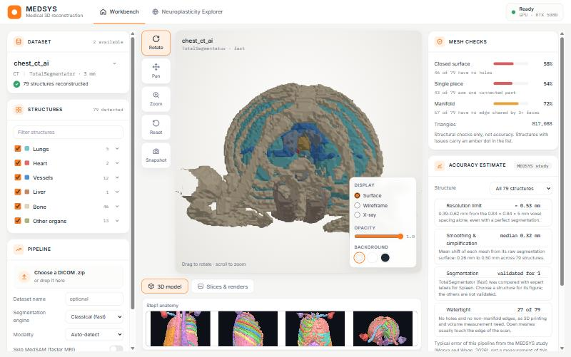
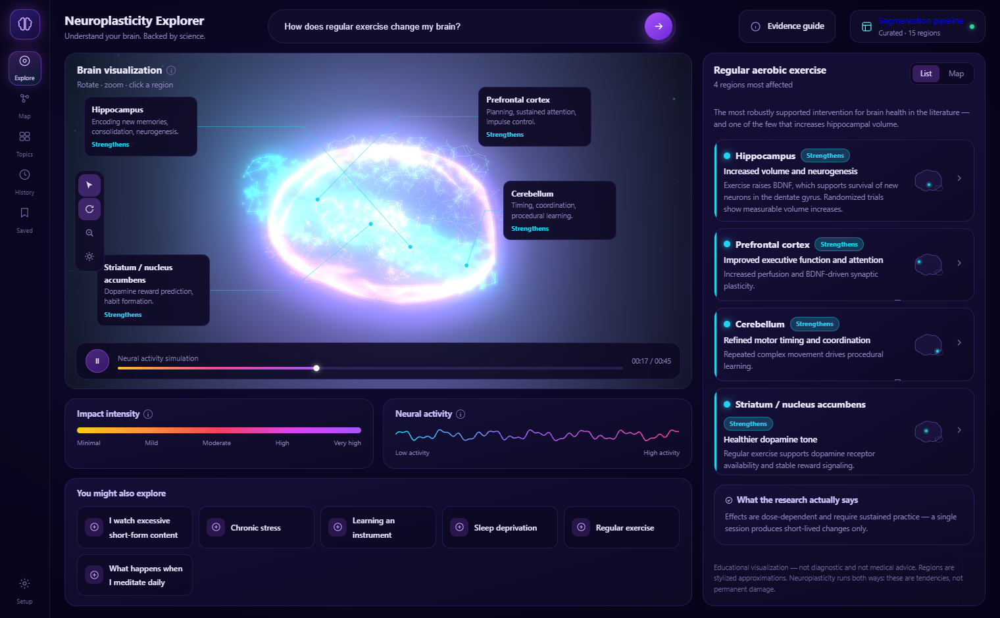
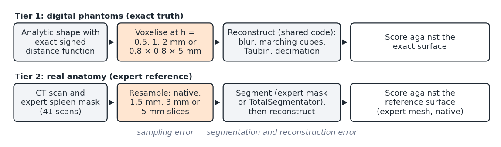
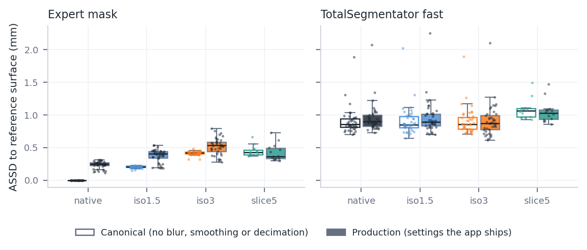

<div align="center">

# MEDSYS

**Risk-aware reconstruction of 3D anatomy from medical scans**

An open platform that turns DICOM studies into per-structure 3D models, and a research project
that measures how far those models can be trusted.

[](LICENSE)
[](#requirements)
[](https://github.com/Organic42/MEDSYS/actions/workflows/python-app.yml)
[](https://github.com/Organic42/MEDSYS/releases/tag/v1.0-paper)
[](#status)

[Product](#the-product) · [Results](#research-results) · [Validation](#validation) · [Paper](#paper) · [Reproduce](#reproducing-the-results) · [Run it](#running-medsys) · [Roadmap](#roadmap) · [Cite](#citation)

<br>



<sub>The workbench on a chest CT segmented by TotalSegmentator: 79 structures in X-ray mode, with live structural checks of every mesh on the right.</sub>

</div>

---

> **Not a medical device.** MEDSYS is for research and education. It is not cleared or certified
> for clinical use and must not inform diagnosis or treatment. See [Disclaimer](#disclaimer).

## At a glance

| | |
|---|---|
| **57,944** | meshes scored against exact or expert reference surfaces |
| **82** | expert-labelled CT scans (41 spleen, 41 pancreas held out), each resampled to 4 acquisition resolutions |
| **0.177 mm** | surface error added per mm of lost sampling (95% CI 0.171–0.184); predicts the held-out pancreas within 0.030 mm |
| **0.76–0.90 mm** | average distance of a finished spleen model from the expert's outline |
| **89.5% / 99.9%** | of an AI engine's surface-error variance that is patient-to-patient (spleen / pancreas) |
| **590** | of the app's own meshes used to check its per-mesh accuracy estimate |
| **28.7 s → 5.3 s** | TotalSegmentator time per CT scan with the persistent GPU worker |
| **118** | automated tests |

## The product

Upload a zipped DICOM study in the browser. MEDSYS detects the modality, segments it, builds one
3D mesh per structure and opens the result in a three-column workbench.



<sub>Pipeline output for the same chest CT: anterior, lateral, posterior and superior views of all 79 structures.</sub>

| | |
|---|---|
| **Modalities** | CT, MRI (brain) and PET, routed automatically from DICOM metadata |
| **Engines** | A fast classical engine (intensity thresholds, BET, Gaussian mixture) and TotalSegmentator (nnU-Net) for 100+ labelled structures, with MedSAM refinement for MRI |
| **Workbench** | Dataset, structures and pipeline on the left; a 3D stage with surface, wireframe and X-ray modes in the centre; mesh checks, the accuracy estimate and reference metrics on the right |
| **Measured, not guessed** | Mesh checks show real structural data (on the CT above: 46 of 79 meshes closed, 43 of 79 in one piece, 58 of 79 manifold, 817,158 triangles). The accuracy estimate gives every mesh the error its voxel spacing alone imposes, measures how far smoothing and simplification moved it, and shows the engine's error against expert labels where the study measured it (TotalSegmentator on spleen and pancreas), saying "not validated" everywhere else. Each line was checked against the true error of 590 of the app's own meshes ([validation report](docs/validation/validation-report.pdf)) |
| **Neuroplasticity Explorer** | Questions about behaviour and the brain, answered from a curated evidence base and mapped onto a 3D brain |
| **Speed** | A persistent GPU worker keeps TotalSegmentator and MedSAM loaded between jobs: 5.3 s instead of 28.7 s of segmentation per CT scan, 52 s instead of 75 s for the whole job |
| **Deployment** | Docker Compose (API, Redis and workers), a lightweight Hugging Face Spaces image with a public demo mode, and a standalone Windows build |



<sub>The current workbench on a public chest CT (TCIA sample): the accuracy estimate card on the right shows the resolution limit, the smoothing shift, the engine's validated error and the watertight count.</sub>



<sub>The Neuroplasticity Explorer: asking how regular exercise changes the brain highlights the four regions most affected and tags each finding by the strength of its evidence.</sub>

## Research question

Automated pipelines can turn a CT scan into a 3D model in minutes, but they do not say how far
that model's surface may be from the real anatomy. Error enters at every stage (acquisition
resolution, segmentation, blurring, surface extraction, smoothing, simplification), and the
stages interact. The thesis is **measure → predict → decide**:

| | Question | Status |
|---|---|---|
| **RQ1 — Measure** | Which pipeline stages, and which interactions between them, contribute most to final geometric error? | Done on phantoms, 41 spleen and 41 held-out pancreas scans, both engine modes; external pilot on AMOS and CT-ORG |
| **RQ2 — Predict** | Can final-mesh error be predicted without ground truth, with calibrated coverage? | Planned |
| **RQ3 — Decide** | Can those predictions select the cheapest pipeline that meets a task's accuracy requirement? | Planned |

Production and research run the same reconstruction code ([`reconstruction.py`](reconstruction.py)),
so every result below describes the meshes the app actually ships.

## Research results



Two references, one factorial design. **Tier 1** reconstructs four analytic phantoms (sphere, thin
capsule, torus, rounded box) at four voxel spacings under 97 configurations, 7,760 meshes, and
scores them against their exact surfaces. **Tier 2** resamples expert-labelled CT (Medical
Segmentation Decathlon: 41 spleen scans, and 41 pancreas scans held out with six hypotheses fixed
before any was processed) to four resolution levels *before* segmentation, segments them with
TotalSegmentator in fast (3 mm) and full (1.5 mm) mode, and reconstructs both the expert mask and
the engine's mask under 49 configurations: 49,200 meshes, plus coarsening-sensitivity runs, 57,944
in total.

### Tier 2: what resolution does to a correct segmentation and to an AI engine

Spleen, TotalSegmentator fast mode. Mean across scans; distances are ASSD in mm against the expert
reference surface; `slice5` covers the 14 scans it actually resampled.

| Source | Resolution | Dice | ASSD, canonical | ASSD, production | Closed meshes |
|---|---|---|---|---|---|
| Expert mask | native | – | 0.000 | 0.234 | 98% |
| | 1.5 mm | 0.985 | 0.204 | 0.374 | 95% |
| | 3 mm | 0.968 | 0.418 | 0.517 | 98% |
| | 5 mm slices | 0.971 | 0.445 | 0.425 | 93% |
| TotalSegmentator (fast) | native | 0.940 | 0.901 | 0.948 | 66% |
| | 1.5 mm | 0.940 | 0.905 | 0.958 | 90% |
| | 3 mm | 0.940 | 0.907 | 0.914 | 95% |
| | 5 mm slices | 0.926 | 1.079 | 1.048 | 50% |



**Key findings**

- **Coarser scans move even a perfect segmentation, and Dice hides it.** The expert mask's surface
  moves 0.20, 0.42 and 0.45 mm at 1.5 mm, 3 mm and 5 mm slices while Dice stays at or above 0.968.
- **A simple sampling relationship.** That movement follows ASSD ≈ 0.177 × Δ (95% CI 0.171–0.184,
  R² 0.76), where Δ is the sampling added by coarsening. It predicts held-out scans almost as well
  (leave-one-scan-out R² 0.75, mean absolute error 0.037 mm), and agrees with the 0.14 × voxel floor
  measured on exact phantom surfaces.
- **For an AI engine, the patient dominates.** Patient-to-patient variation explains 89.5% of
  TotalSegmentator's error variance (95% CI 65.0–95.2%; 94.2% in a random-intercept model).
  Its error does not change from native to 3 mm grids (0.901 → 0.907 mm) but rises by 0.188 mm
  with 5 mm slices.
- **Stages interact, so errors cannot simply be added.** On phantoms, interactions carry about a
  third of the error variance, and smoothing helps compact shapes but quadruples the thin capsule's
  error at 2 mm (0.425 → 1.696 mm).
- **Decimation costs topology, not geometry.** On unsmoothed meshes, removing up to 50% of faces
  leaves the surface unchanged in 34–39 of 41 scans, yet at 75% only 57–83% of meshes stay closed.
- **A practical fix.** Meshing TotalSegmentator's output on its own 3 mm grid raises closed meshes
  from 66% to 95% and cuts the median mesh from 19,520 to 2,600 faces. At identical physical
  settings, the accuracy change is negligible (−0.017 mm); the gain is topology and size.

### Held-out organ and full-resolution mode

| | Spleen | Pancreas (held out) |
|---|---|---|
| Engine ASSD at native resolution, fast / full mode | 0.901 / 0.790 mm | 2.722 / 3.021 mm |
| Share of engine error variance from the scan | 89.5% | 99.9% |
| Sampling relationship (slope) | 0.177 (the fit) | 0.180; spleen fit predicts it within 0.030 mm |

Of the six hypotheses fixed from the spleen before any pancreas scan was processed, four held,
one held partly (meshing on the engine's grid again closed 25 points more meshes, but cost
0.085 mm) and one did not (a 3 mm grid raised the pancreas error by 0.120 mm, beyond the ±0.10 mm
margin). Full mode is better on native spleen scans but loses 0.42 mm on 3 mm input and does not
help the pancreas. Much of the pancreas error is tumour the engine leaves out.

### Tier 1: reconstruction error against exact surfaces

ASSD in mm (HD95 in brackets) of the canonical reconstruction, mean of five placements. It is
about 0.14 × the voxel size and sets the floor below which anatomy results cannot be interpreted.

| Phantom | 0.5 mm | 1 mm | 2 mm | 0.8 × 0.8 × 5 mm |
|---|---|---|---|---|
| Sphere | 0.070 (0.17) | 0.147 (0.34) | 0.271 (0.75) | 0.495 (1.62) |
| Capsule, r 2 mm | 0.069 (0.17) | 0.144 (0.35) | 0.331 (0.77) | 0.634 (1.95) |
| Torus | 0.068 (0.16) | 0.138 (0.33) | 0.278 (0.66) | 0.499 (1.61) |
| Rounded box | 0.072 (0.17) | 0.145 (0.33) | 0.297 (0.68) | 0.525 (1.72) |

Voxel spacing is the largest factor (38.8% of error variance, 95% CI 36.1–42.0%; 68.6% on a log
scale). The app's default settings shrink the 2 mm capsule by 1.13 mm at 2 mm voxels, more than
half its radius, because their blur is set in voxels.

### Compute cost

One 192-slice 1 mm brain MRI on an RTX 5080 (16 GB) and a 6-core CPU, PyTorch 2.12 with CUDA 13.0.

| Stage | CPU | GPU | Speed-up |
|---|---|---|---|
| MedSAM refinement | 432.8 s | 24.5 s | 17.7× |
| Whole MRI pipeline | 540 s | 132 s | 4.1× |
| TotalSegmentator MRI, fast (3 mm) | 24.2 s | 29.2–30.5 s warm | none |
| TotalSegmentator MRI, full (1.5 mm) | 60.2 s | 38.7 s warm | 1.6× |

On CT, TotalSegmentator fast mode took 17–30 s per scan on the GPU across the 96 Tier 2 runs.
Most of that was not inference: each job started a new process that reloaded PyTorch and the
model, and on Windows nnU-Net and TotalSegmentator spawn helper processes that do the same.
The app now keeps a **persistent GPU worker** (`gpu_worker.py`) with the models loaded, which
runs that work in-process. On a 64-slice chest CT:

| Stage | Per-job process | Persistent GPU worker |
|---|---|---|
| TotalSegmentator CT, fast (3 mm) | 28.7 s | 5.3 s (5.4×) |
| Whole job, 79 structures meshed | 75 s | 52 s |

The masks match TotalSegmentator's own output to within its run-to-run variation (nnU-Net uses
cuDNN autotuning, so two processes can differ in a few hundred of 2.3 million voxels).

## Validation

The research measures the method; these tests check what the application itself delivers. Full
report: [`docs/validation/validation-report.pdf`](docs/validation/validation-report.pdf).

| Test | Question | What was done | Result |
|---|---|---|---|
| 1 · Accuracy estimate ([`card_validation.py`](research/card_validation.py)) | Is the accuracy the app shows honest? | The app's own meshing code on all 82 scans, both modes and 4 grids (590 meshes); each line of the estimate compared with the true error, leave one scan out. About 4 min | Resolution limit inside its interval for 98% of held-out pancreas grids; smoothing shift correct to 0.022 mm; watertight flag right for 590 of 590. The engine figure was overconfident on coarse grids (as low as 15% in its middle half); fixed, it holds 50% and 86% in its 9-in-10 range (targets 50% and 90%) |
| 2 · Repeatability ([`repeatability.py`](research/repeatability.py)) | Does the same scan always give the same model? | 10 scans, 184 runs: persistent GPU worker, a new GPU process each run, and the CPU. About 2 h | Identical masks in all 80 repeats on the worker; a new process or the CPU changed at most 96 organ voxels and moved the mesh by at most 0.025 mm |
| 3 · Printed phantom ([`physical_phantom.py`](research/physical_phantom.py)) | Is it accurate on a real object? | Seven printable shapes with exact surfaces (sphere, box, torus, 2/4/6 mm tubes, a bifurcation), a print-and-scan [protocol](docs/validation/phantom/README.md) and an analysis tested on simulated CT | Ready; awaiting a CT scanner session |
| 4 · New hospitals ([`card_external.py`](research/card_external.py)) | Does it hold on data from other centres? | Pilot on 5 AMOS and 5 CT-ORG scans (liver, spleen, pancreas, aorta, vena cava, lungs, bone). About 1 h | Resolution limit and watertight flag transfer; the engine figure is optimistic at the new centre (spleen about 1.2 mm against 0.8 mm stated). Full run next |

**Fixed because of the tests:** the engine figure now uses the reference measured on the study
grid closest to the scan; the resolution range's lower bound moved from 0.14 to 0.13; the
repeat-check no longer treats two blank values as different; label values are rounded before use
(CT-ORG stores them as floats just below the integer); structures outside a scan's field of view
are recorded instead of stopping a run; and MSD Task08 hepatic vessels was dropped as test data,
because TotalSegmentator's own liver-vessel model is trained on it.

**How accurate is a model?** About 0.1 voxel against the scan itself (the meshing step), 0.76 to
0.90 mm against an expert's outline for the spleen and about 2 mm for the pancreas, and not yet
measured against the real organ (test 3).

## Paper

**Stage-Wise Attribution of Geometric Error in Automatic Anatomical Surface Reconstruction From
Computed Tomography.** Sameer Morya and Sarthak Wage. IEEE conference format, 6 pages.

- PDF (revised after review: held-out pancreas, both engine modes): [`docs/paper/medsys-paper.pdf`](docs/paper/medsys-paper.pdf);
  the first version is attached to release [`v1.0-paper`](https://github.com/Organic42/MEDSYS/releases/tag/v1.0-paper)
- Supplement S1–S14, including repeatability (S13) and the accuracy estimate (S14):
  [`docs/paper/supplement/medsys-supplement.pdf`](docs/paper/supplement/medsys-supplement.pdf)
- Point-by-point response to the review: [`docs/paper/response-to-review.pdf`](docs/paper/response-to-review.pdf)
- Source and reproduction steps: [`docs/paper/`](docs/paper/)
- Longer Tier 2 report: [`docs/tier2-report/`](docs/tier2-report/)

## Reproducing the results

Every table and figure is generated from the saved per-mesh results in
[`research/results/`](research/results/), so they can be rebuilt without re-running the experiments.

```bash
pip install -r requirements-full.txt

# Rebuild the paper's statistics, tables and figures from the saved results
python -m research.paper_stats --tier1 research/results/tier1_phantoms_20261002-222422_full \
       --tier2 research/results/tier2_spleen_two_modes_20261018-210930 \
       --pancreas research/results/tier2_pancreas_heldout_20261018-223006 --out docs/paper

# Or re-run the experiments (seed 2026)
python -m research.phantom_experiment --preset full      # 7,760 meshes, about 3 min on 6 cores
python -m research.tier2 --dataset msd_spleen --data data/msd/Task09_Spleen --preset full --engines ts_fast,ts_full --workers 5
python -m research.tier2 --dataset msd_pancreas --data data/msd/Task07_Pancreas --preset full --sample 41 --engines ts_fast,ts_full

# Validation of the application (needs the Tier 2 engine cache)
python -m research.card_validation --workers 8           # test 1, about 4 min
python -m research.repeatability                         # test 2, about 2 h on one GPU
python -m research.tier2 --dataset amos --data data/amos/amos22 --preset pilot --sample 5 --engines ts_fast,ts_full
python -m research.card_external                         # test 4, on the cached AMOS masks
python docs/validation/make_report.py --pdf              # validation report from the saved runs

# Tests
pytest                                                   # 118 tests
```

Full commands, software versions and a map from each paper item to its source:
[`docs/paper/README.md`](docs/paper/README.md). Experiment details:
[`research/README.md`](research/README.md).

## Running MEDSYS

```bash
pip install -r requirements-full.txt
python app.py                         # http://127.0.0.1:8000

docker compose up --build             # API + Redis + workers
python segmentation_pipeline.py --input <dicom_dir> --name <dataset> --engine totalseg
```

<details>
<summary><strong>Deployment options</strong></summary>

<br>

- **Hugging Face Spaces:** `Dockerfile.web` with `requirements-web.txt` builds a CPU-only image
  without PyTorch or TotalSegmentator; the front matter at the top of this file configures the
  Space. The UI detects missing engines through `/api/capabilities`. The image runs in **public
  demo mode** (`publicdemo.py`): each visitor sees only their own scans plus a preloaded sample
  chest CT, uploaded DICOMs are deleted as soon as a job finishes and results after an hour,
  uploads are capped at 200 MB and three jobs at a time, and a banner asks for anonymised or
  public scans only. Publish with `hf auth login`, then
  `python deploy/hf_space.py <username>/<space-name>`.
- **Windows:** `python -m PyInstaller medsys.spec --noconfirm` produces `dist/MEDSYS/`, which runs
  without Python.
- **GPU:** install a CUDA build of PyTorch that supports your card. RTX 50-series cards need
  CUDA 12.8 or newer. Jobs fall back to the CPU when no GPU is found. With a GPU, `app.py` (or
  `worker.py` under Redis) starts the persistent GPU worker, which keeps TotalSegmentator and
  MedSAM loaded between jobs; `/api/capabilities` reports it as `gpu_worker: warm`. If it is
  not running or a request fails, the job runs the step in its own process as before. Set
  `VRSEG_GPU_WORKER_MODE=off` to disable it. `VRSEG_ACCURACY=off` skips the per-mesh accuracy
  estimate, which adds about 0.1 s per mesh.

</details>

<details>
<summary><strong>Pipelines</strong></summary>

<br>

- **CT (classical):** Hounsfield units → windowing → body mask → lungs (border clearing) →
  skeleton (HU > 200) → soft tissue → meshes.
- **MRI brain (classical):** N4 bias correction → non-local-means denoising → BET skull strip →
  optional box-prompted MedSAM refinement → grey/white matter/CSF by Gaussian mixture → meshes.
- **PET:** activity normalisation → hotspot by tumour-to-background ratio → maximum-intensity
  projections and meshes.
- **TotalSegmentator:** DICOM → NIfTI → nnU-Net (CT or MR task, 3 mm fast mode in the app) →
  one mesh per structure.

Every route meshes through [`reconstruction.py`](reconstruction.py): Gaussian blur of the mask,
marching cubes, Taubin smoothing and decimation, with explicit, recordable parameters.

</details>

<details>
<summary><strong>Architecture</strong></summary>

<br>

```
Browser ──upload──▶ FastAPI (app.py) ──▶ job queue (in-process, or Redis + RQ)
                                              │
                                              ▼
                      segmentation_pipeline.py (subprocess per job)
                      ├─ modality detection and routing
                      ├─ classical engine / TotalSegmentator
                      └─ reconstruction.py ──▶ meshes + report.json
                                              │
              SQLite job store ◀──────────────┤
                                              ▼
                      Workbench (three.js) ◀── /api/datasets, /output/<dataset>/*.stl
```

Job state lives in SQLite, so it survives restarts and is shared by the API and workers. Each
segmentation runs as a subprocess, so a crashing job cannot take the service down.

</details>

## Repository structure

```
MEDSYS/
├── reconstruction.py          # Shared mesh reconstruction (production and research)
├── segmentation_pipeline.py   # Modality-aware segmentation pipelines
├── accuracy.py                # Per-mesh accuracy estimate
├── gpu_worker.py, medsam.py   # Persistent GPU worker; MedSAM loading and refinement
├── publicdemo.py              # Public demo mode: per-visitor data, retention, limits
├── validate.py                # Reference comparison: Dice, IoU, HD95, ASSD
├── research/                  # Tier 1 and Tier 2 experiments, validation tests, paper statistics
│   └── results/               # Per-mesh results behind the paper and the validation (compressed)
├── docs/
│   ├── paper/                 # The paper, supplement and response to review
│   ├── validation/            # Validation report, figures, printed-phantom protocol
│   ├── tier2-report/          # Detailed Tier 2 report
│   └── images/                # README screenshots and figures
├── tests/                     # 118 tests: pipeline, accuracy estimate, GPU worker, public demo, phantoms, Tier 2
├── samples/                   # Public de-identified chest CT used by the demo
├── deploy/                    # Hugging Face Space publisher
├── app.py, tasks.py, worker.py, jobstore.py, config.py   # Web service and job handling
├── web/                       # Workbench and Neuroplasticity Explorer
├── brain_knowledge.py         # Explorer evidence base
└── Dockerfile, Dockerfile.web, docker-compose.yml, requirements*.txt
```

## Roadmap

**Research**
- [x] Tier 1: phantom experiment with exact surfaces
- [x] Tier 2: 41 expert-labelled CT scans with acquisition resolution as a factor
- [x] Scan-clustered attribution and validation of the sampling relationship
- [x] Paper draft (IEEE conference format)
- [x] Held-out second organ: MSD Pancreas, 41 scans, hypotheses fixed beforehand
- [x] TotalSegmentator full-resolution (1.5 mm) model
- [x] External-data pilot: AMOS and CT-ORG (liver, lungs, bone, aorta, vena cava)
- [ ] Full external runs (40+ AMOS scans) and recalibration of the engine figure across centres
- [ ] Agreement with experts: MEDSYS against inter-annotator variation
- [ ] Third dataset with real thin and thick reconstructions of the same scans
- [ ] Systematic, logged literature search to confirm novelty
- [ ] RQ2: ground-truth-free error prediction with calibrated intervals
- [ ] RQ3: accuracy-constrained pipeline selection

**Platform**
- [x] Shared, parameterised reconstruction module
- [x] GPU inference with measured CPU and GPU timings
- [x] Browser-side mesh checks
- [x] Accuracy estimate per mesh, from the study's results (`accuracy.py`)
- [x] Persistent GPU worker (`gpu_worker.py`)
- [x] Validation of the accuracy estimate and of repeatability ([`docs/validation/`](docs/validation/))
- [x] Public demo mode with a de-identified sample scan
- [ ] Physical phantom in a real CT scanner (kit, protocol and analysis ready)
- [ ] Parallel meshing across CPU cores (meshing is now the slowest step, about 44 s)
- [ ] Mesh TotalSegmentator output on its working grid (confirm on CT-ORG first)
- [ ] Blur specified in millimetres in production
- [ ] Verified de-identification and opaque dataset identifiers
- [ ] DICOM-SEG export and a provenance record on every output

## Status

A working research prototype. The platform runs end to end and its 118 tests pass. RQ1 has results
on phantoms and on two organs (spleen, and the pancreas held out; 41 scans each) with both
TotalSegmentator modes. Validation tests check what the app itself delivers: its accuracy
estimate against the true error of 590 of its meshes, the repeatability of the same scan across
184 runs, and a first pilot on data from other centres (AMOS, CT-ORG)
([report](docs/validation/validation-report.pdf)). A printed-phantom test is ready and waits for
scanner time.

**Limitations.** Real-anatomy results cover two organs from one public dataset and one engine; the
external pilot has 5 scans per dataset, and there the engine figure was optimistic.
Coarser acquisition was simulated by resampling, not by rescanning. The reference surfaces carry
the native scan's own sampling error, so differences below about 0.2–0.5 mm cannot be called
anatomical error. No claim here should be read as clinical accuracy.

## Requirements

- Python 3.10+
- `requirements-full.txt` for all engines; `requirements-web.txt` for the lightweight image
- Optional: an NVIDIA GPU with a matching CUDA build of PyTorch (MedSAM and TotalSegmentator)
- Optional: Docker

## Citation

```bibtex
@misc{morya2026medsys,
  author = {Morya, Sameer and Wage, Sarthak},
  title  = {Stage-Wise Attribution of Geometric Error in Automatic Anatomical Surface
            Reconstruction From Computed Tomography},
  year   = {2026},
  note   = {MEDSYS, release v1.0-paper},
  url    = {https://github.com/Organic42/MEDSYS}
}
```

MEDSYS builds on TotalSegmentator (Wasserthal et al., *Radiology: Artificial Intelligence*, 2023),
nnU-Net (Isensee et al., *Nature Methods*, 2021), MedSAM, BET, N4ITK and marching cubes, and the
Tier 2 data come from the Medical Segmentation Decathlon (Antonelli et al., *Nature
Communications*, 2022); the external pilot uses AMOS (Ji et al., NeurIPS 2022, CC BY 4.0) and
CT-ORG (Rister et al., *Scientific Data*, 2020, CC BY 3.0); please cite them where you use them.

## Authors

- **Sameer Morya**
- **Sarthak Wage** ([Organic42](https://github.com/Organic42))

Issues and pull requests are welcome. Please run `pytest` before submitting, and never commit
patient data, DICOM files, model checkpoints or pipeline output (`.gitignore` excludes them).

## Disclaimer

MEDSYS is provided for **research and education only**. It is not a medical device, has not been
evaluated by any regulatory body, and must not be used to diagnose, treat or otherwise make
clinical decisions. Outputs from any engine may contain errors. Always defer to qualified
clinicians and validated clinical software.

## License

MIT. See [LICENSE](LICENSE). Tier 2 results in `research/results/` are derived from CC-BY-SA 4.0
data and shared under that licence.
